<picture>
  <source media="(max-width: 600px)" srcset="docs/assets/hero-mobile.svg">
  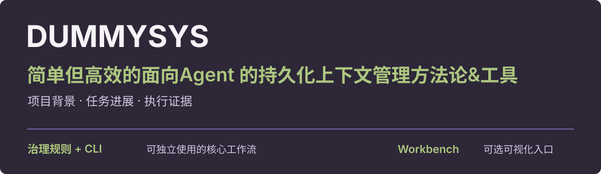
</picture>

<p align="center">
  以治理规则与 CLI 组织项目知识、任务进展和执行证据。<br>
  将分散在会话和目录中的工作信息，沉淀为可接续、可检索、可追溯的项目记录。<br>
  Workbench 是可选的可视化工作台，核心工作流可以独立使用。
</p>

<p align="center">
  <a href="#project--task--run上下文的三个层级">上下文模型</a> ·
  <a href="#agent-如何按规则建项目和写文档">规则与 CLI</a> ·
  <a href="#从已有记录继续工作">恢复上下文</a> ·
  <a href="#自定义项目首页">自定义项目首页</a> ·
  <a href="#workbench可选的可视化工作台">界面与体验</a> ·
  <a href="#安装与开始使用">开始使用</a> ·
  <a href="docs/workflow.md">工作方法</a>
</p>

<p align="center">
  <a href="LICENSE.txt"></a>
  
  <a href="docs/platform-and-data.md"></a>
</p>

## 从日常对话开始

项目持续推进，上下文却往往留在不同的会话里：实验产物散落在各处，结果与配置难以对应，隔一段时间再继续，又要重新整理背景。

<picture>
  <source media="(max-width: 600px)" srcset="docs/assets/context-files-mobile.png">
  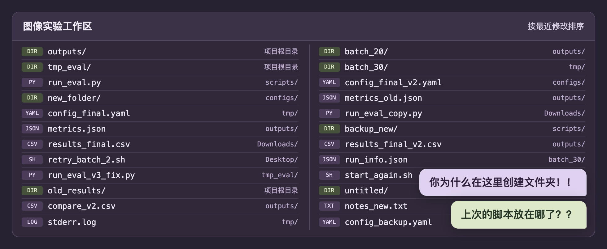
</picture>

<picture>
  <source media="(max-width: 600px)" srcset="docs/assets/context-chat-hd-mobile.png">
  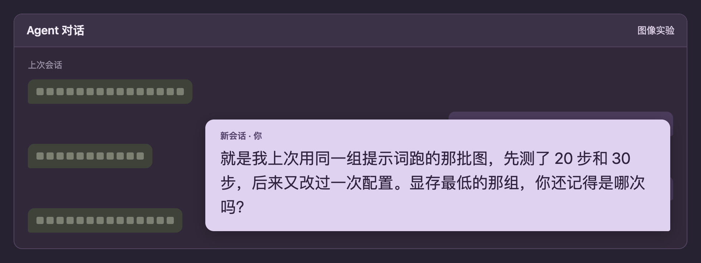
</picture>

DUMMYSYS 从这些日常问题出发，让 Agent 在执行工作的同时，维护可接续、可检索、可追溯的项目记录。你仍然用自然语言描述目标，记录的组织交给遵循工作区规则的 Agent。

### 创建项目，为后续工作建立共同背景

你提出项目目标，Agent 按工作区规则用 CLI 建项目，再打开返回的项目 README，写下研究目标和资料入口。

<picture>
  <source media="(max-width: 600px)" srcset="docs/assets/dialogue-project-mobile.svg">
  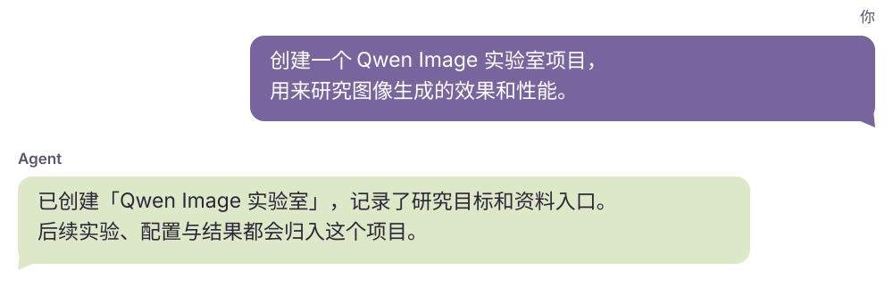
</picture>

### 你的 Agent 理解意图，也懂得组织工作

你只需描述想达成的结果。Agent 结合项目背景理解意图，识别工作范围，主动创建或接续相应任务，并为每次实际执行保存记录。

<picture>
  <source media="(max-width: 600px)" srcset="docs/assets/dialogue-task-mobile.svg">
  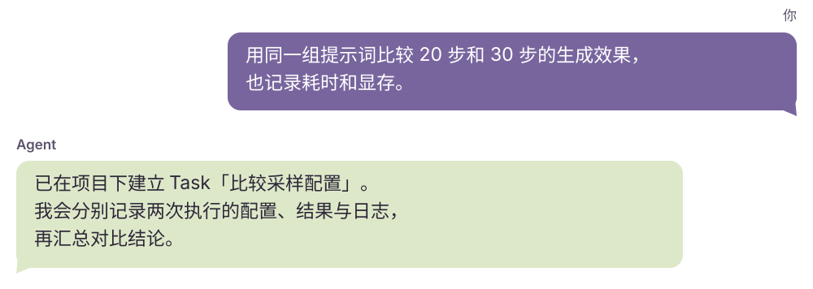
</picture>

### 只记得大致结果，也能追溯对应的执行

实验积累后，你可能只记得“那次显存比较低”，却记不起文件名。Agent 可以先缩小任务范围，再查阅多次 Run 的配置、结果和证据，让回答有据可查。

<picture>
  <source media="(max-width: 600px)" srcset="docs/assets/dialogue-retrieve-mobile.svg">
  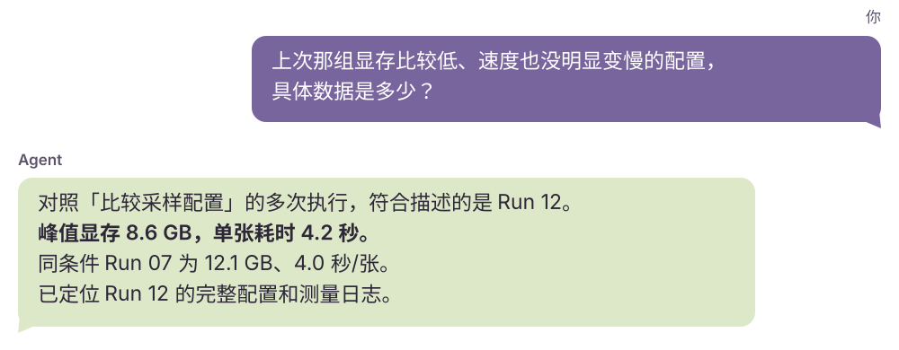
</picture>

<p align="center"><sub>对话为工作流示意，指标为合成数据。语义理解与资料检索由接入的 Agent 完成，CLI 负责受管记录操作。</sub></p>

这三段对话对应着同一个需求：**让项目背景、工作目标和每次执行的事实保持关联。** 要让记录在会话结束后仍然可用，需要一套明确的上下文结构。

## Project / Task / Run：上下文的三个层级

DUMMYSYS 将这些信息组织为三个层级：**Project 保存项目背景，Task 维护一项工作的当前状态，Run 记录一次执行的具体事实。** 上面的图像实验项目，就可以这样展开：

<picture>
  <source media="(max-width: 600px)" srcset="docs/assets/ptr-model-mobile.svg">
  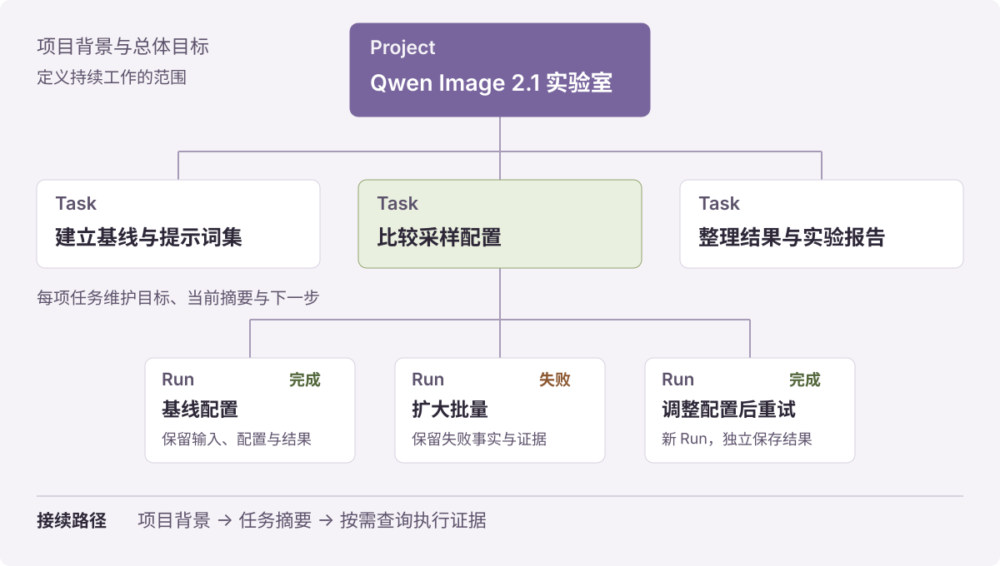
</picture>

**一个 Task 可以跨多次对话，一个 Project 可以关联多个代码仓库，也可以完全没有代码。** 普通阅读和随手笔记不必都建立 Task / Run。

接续时先读取项目背景与任务摘要，再按需查询执行证据。失败的 Run 保留原始事实，重试创建新 Run；执行结束后，将影响后续工作的结论更新到 Task。因此，“比较采样配置”不依赖某一段聊天而存在；找回某次实验的数据时，也可以沿着任务定位到对应 Run 的配置、结果与日志。

## 文档、执行资源与代码的职责划分

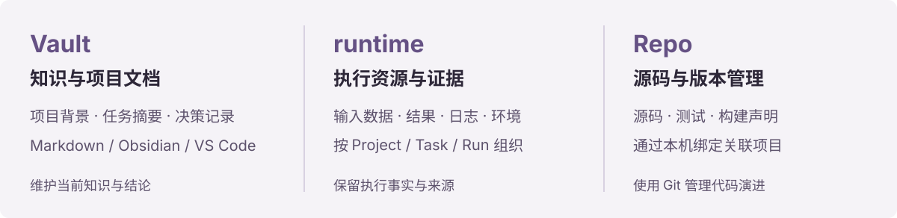

- **Vault · 知识与项目文档**：保存项目背景、任务摘要、决策与知识笔记。采用 Markdown，可通过 Obsidian 或 VS Code 阅读和维护。
- **runtime · 执行资源与证据**：保存输入数据、实验结果、日志、运行环境与本机配置，按所属项目、任务和 Run 组织。
- **Repo · 源码与版本管理**：保存持续维护的源码、测试和构建声明，通过本机绑定关联项目。

runtime 同时包含临时资源与需要长期保留的执行证据，清理时应按内容与归属处理。Vault 和 runtime 的位置可独立配置。

## Agent 如何按规则建项目和写文档

**`AGENTS.md` 是工作区的入口。** Agent 开工前从这里读起，顺着指引找到项目资料和该遵循的规则，也知道正文放哪、执行产物放哪、哪些操作要交给 CLI。

<picture>
  <source media="(max-width: 600px)" srcset="docs/assets/agent-governance-mobile.png">
  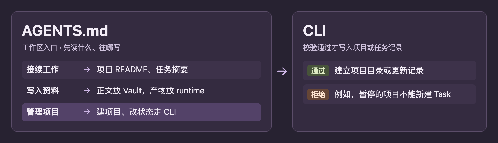
</picture>

**CLI 会强制校验它管理的操作。** 比如，Agent 尝试在已暂停的项目里新建 Task，CLI 会拒绝。当你请 Agent 创建一个项目，CLI 负责建好目录和记录，Agent 则按规则把项目目标、计划和资料入口写进 Markdown。

## 从已有记录继续工作

**换个会话，也能从上次的进度接上。** 告诉 Agent 要继续哪个任务，它先从 Project 找回背景和约束，再从 Task 的当前摘要确认已做什么、下一步是什么。需要核对旧配置或结果时，再查对应的 Run。

<picture>
  <source media="(max-width: 600px)" srcset="docs/assets/context-recovery-mobile.png">
  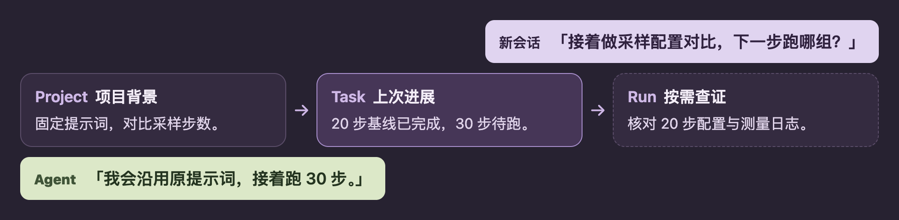
</picture>

做完这一轮，Agent 把结论和下一步写回同一个 Task，执行证据留在 Run。过几天回来，或换一个 Agent 接手，最新进展就在任务摘要里。

## Workbench：可选的可视化工作台

当记录逐渐丰富，除了通过 Agent 查阅，也可以直接浏览项目、任务与执行过程。Workbench 基于同一套文件与记录，提供导航、目录浏览、文档预览、搜索和受管记录操作。

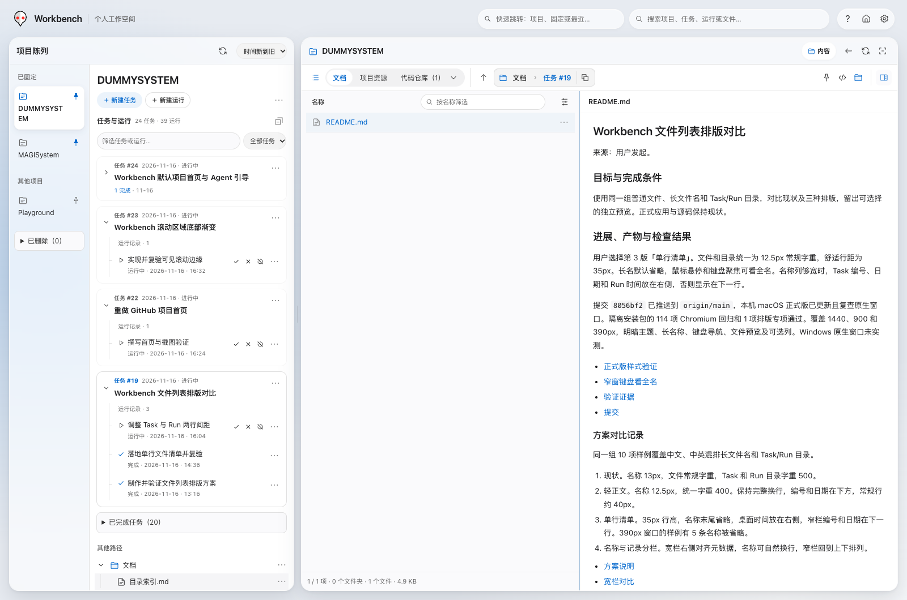

<p align="center"><sub>作者当前工作区实拍：DUMMYSYSTEM 项目的真实任务、Run 和进展记录。</sub></p>

### 自定义项目首页

Project / Task / Run 让信息有了归属和检索路径，但随着记录增多，查看常用数据时，仍可能需要反复请 Agent 搜索、整理。对于经常关注的指标、结果对比或阶段进展，更直接的方式是把它们整理成一个固定页面。

**Workbench 支持为每个项目配置独立的 HTML 首页，把高频信息呈现为符合你工作习惯的视图。** 模型实验可以并排比较生成结果与性能指标，研究项目可以组织文献和结论，产品开发可以汇总阶段进展与交付物。你决定关心什么、如何展示，Agent 根据已有资料生成或更新页面，并保留通向原始记录的入口。

这样，偶尔需要的信息仍可按需检索，常用信息则打开项目就能看到；同一批记录，也可以按你需要的形式重新组织。

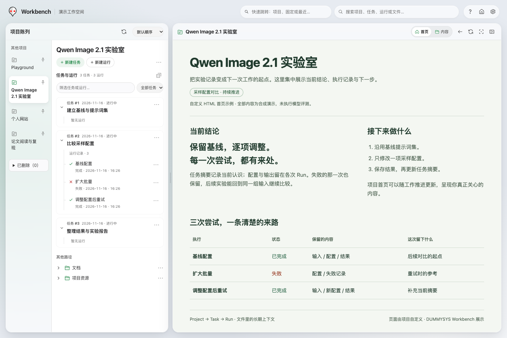

<p align="center"><sub>自定义 HTML 首页示例，使用合成数据；页面由项目自行编写，并非内置模型评测功能。</sub></p>

首页可以用 HTML / CSS / JavaScript 自定义，加载页面包中的相对资源；已有报告也能通过显式声明的目录引用接进来。页面在隔离环境中展示。示例源码见 [项目首页 HTML](docs/assets/demo-project.html)。

<details>
<summary><strong>配置 HTML 项目首页</strong></summary>

将页面包放入项目资源目录，例如 `homepage/index.html`，并在项目资源根的 `workbench.json` 中配置：

```json
{
  "schema_version": 1,
  "homepage": {
    "root_id": "resources",
    "path": "homepage/index.html"
  }
}
```

如果已有 `workbench.json`，保留原有字段并合入 `homepage`。刷新后，Workbench 会显示「项目首页」入口。

</details>

### 工作区概览

多个项目并行时，Workbench 的全局首页可以集中查看项目状态、空间占用和机器档案。

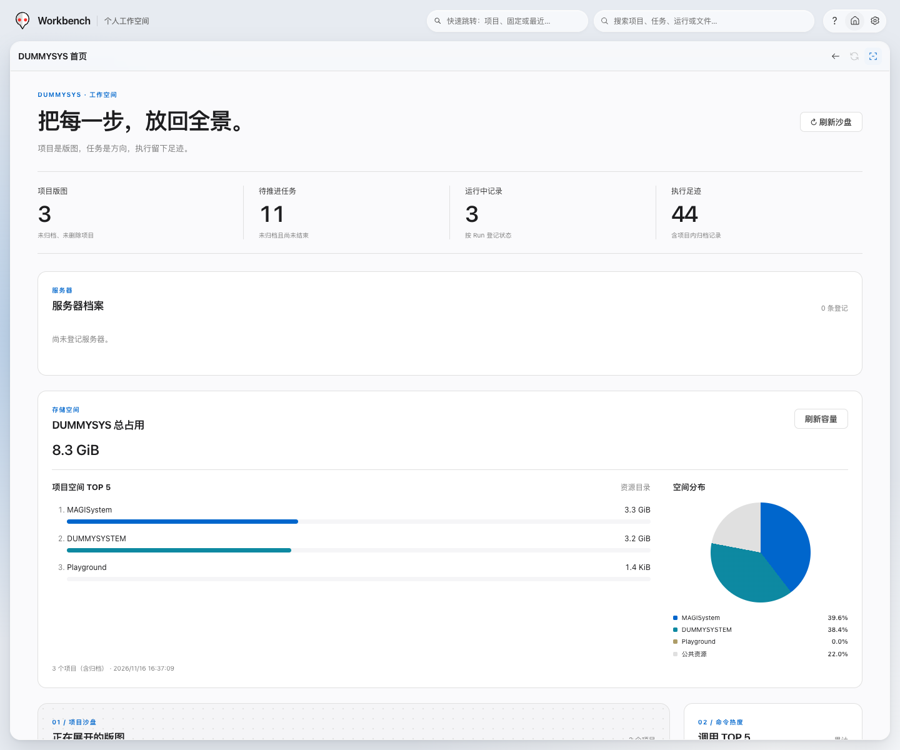

<p align="center"><sub>作者当前工作区实拍：项目状态与真实空间占用；这台机器尚未登记服务器档案。</sub></p>

空间看板按项目呈现资源占用，机器档案汇总已登记的设备信息及最近核查结果。项目状态、执行记录与资源概览共同构成工作区的全局视图。

## 适合谁使用

- **使用 Agent 的开发者**：区分可维护源码与执行产物，保留开发任务的背景、决策和验证记录。
- **研究、实验与数据分析人员**：关联多次执行的输入、配置、结果和证据，支持比较与追溯。
- **持续推进多个项目的个人用户**：在跨会话、跨阶段工作中，通过当前摘要恢复必要背景。
- **采用本地知识管理工作流的用户**：以 Markdown 保存资料，沿用 Obsidian、VS Code 等阅读与编辑工具。

接入的 Agent 需要具备本地文件读写、CLI 执行和规则遵循能力。项目与任务身份独立于具体会话；Agent 团队调度、跨机器自动同步和多端同时写入不在当前范围内。

## 安装与开始使用

目前从源码安装，面向 Windows 与 macOS。你可以选择：

- **规则 + CLI**：使用完整的核心工作流，直接在 Agent、终端和编辑器里工作。
- **加上 Workbench**：获得可视化浏览、自定义项目首页、空间与机器概览。它依赖 core / CLI 管理记录。

下面的安装指令默认包含可选的 Workbench。只想使用核心时，将第一句改成“请只安装 DUMMYSYS 的 CLI 和共享 core，并初始化工作区，不安装 Workbench”，按 [CLI 说明](dummysys-cli/README.md) 与包声明完成独立安装；对应验收以 CLI/core 为范围。

可将以下指令交给具备本机终端执行能力的 Agent：

```text
请在我的电脑上从源码安装 DUMMYSYS，包括 CLI 和 Workbench。
将 https://github.com/HAAZZZEEEE/DUMMYSYSTEM.git 克隆到独立的源码目录，
然后阅读仓库根目录的 AGENTS.md 和 INSTALL.md。
将构建产物放在源码和工作区之外。使用我指定的工作区路径，
默认是当前用户主目录下的 DUMMYSYSTEM。
按 INSTALL.md 检查环境和目标工作区，执行本机系统对应的构建和安装步骤。
使用安装回执中的入口完成 INSTALL.md 的「安装后验收」。
报告工作区路径、CLI 和 Workbench 入口、源码提交，
以及实际验收结果和未验证项。
```

安装完成后，可以发给 Agent 这样一条指令：

> 请先读取 `<工作区绝对路径>/AGENTS.md`，按里面的规则创建「Qwen Image 实验室」项目。把研究目标写进项目 README：比较不同采样配置的画质、耗时和显存。

完整流程可以用合成资料跑一遍。[入门演练](docs/quickstart.md)

| 操作 | 文档入口 |
| --- | --- |
| 手动安装 / 更新已有安装 | [安装指南](INSTALL.md) · [更新指南](docs/update.md) |
| 理解记录与接续方式 | [工作方法](docs/workflow.md) · [CLI 参考](dummysys-cli/apps/cli/docs/commands.md) |
| 调整存储位置、导入或导出项目 | [存储位置](docs/storage.md) · [导入导出](docs/transfer.md) |
| 保护长期资料 | [备份与恢复](docs/backup-restore.md) |
| 了解平台范围 / 参与开发 | [双平台与数据互通](docs/platform-and-data.md) · [开发说明](docs/development.md) |

<details>
<summary><strong>项目现状、许可与维护范围</strong></summary>

DUMMYSYS 来自作者的个人工作流，也会继续围绕实际使用迭代。仓库公开分享代码与工作方法，使用者自行负责部署、备份和数据；项目不承诺升级迁移、版本兼容或稳定性维护。

共享 core / CLI 支持 Windows 与 macOS，Workbench 通过平台适配器运行本机服务与原生窗口。macOS 已纳入安装和功能验证；Windows 原生回归及真实跨机器往返仍须在相应机器完成。浏览器截图不代表原生平台验收。

一个 Git 仓库管理 CLI、共享 core 和 Workbench，构建三个安装包。文件与 CLI / JSON 可独立使用。普通浏览不要求 Obsidian；改名、移动与归档依赖它更新链接，缺少相应能力时会明确拒绝。

自有代码与随附方法论文档采用 [MIT 许可证](LICENSE.txt)。第三方声明见 [THIRD_PARTY.md](THIRD_PARTY.md)，首页图片来源与复拍说明见 [资产说明](docs/assets/README.md)。

</details>

---

<p align="left"></p>

《新世纪福音战士》中的 **DUMMY SYSTEM（ダミーシステム）**，通过模拟驾驶员的信号操纵 EVA。当人性的藩篱难以逾越时，它以程序的精确，优雅地将残酷化为现实。

<p></p>

<p align="center">
  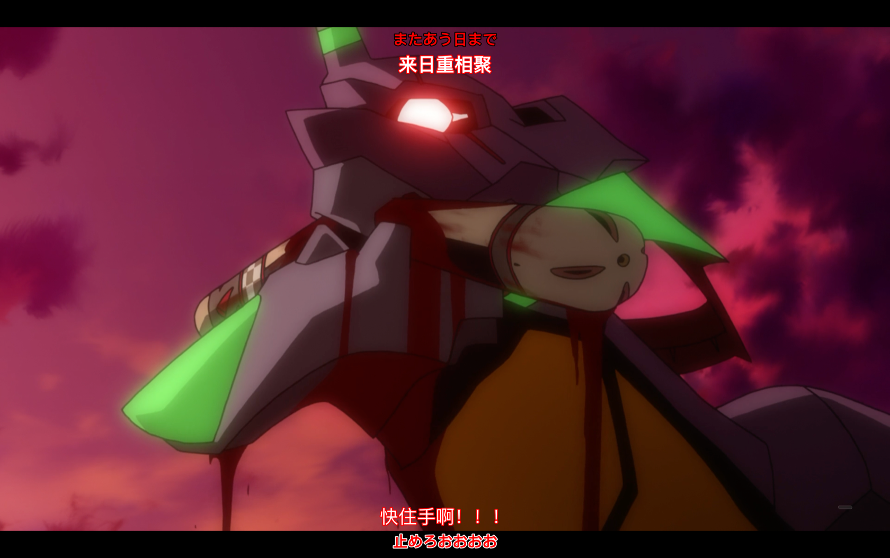
</p>
<p align="center">
  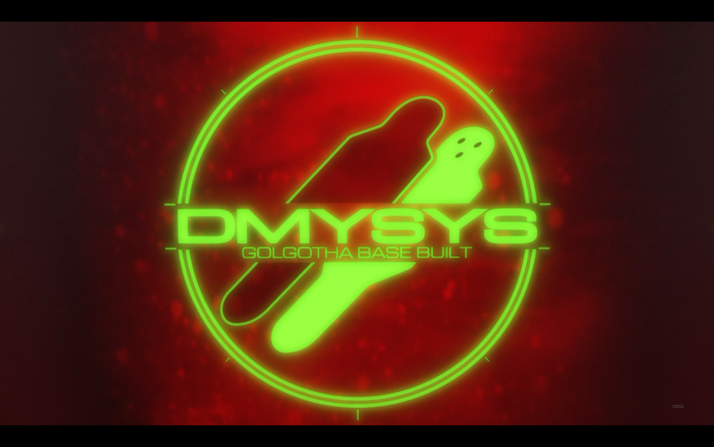
</p>
<p align="center"><sub>《新世纪福音战士》系列画面 · 版权归原作权利人所有。</sub></p>

<p align="right"></p>
